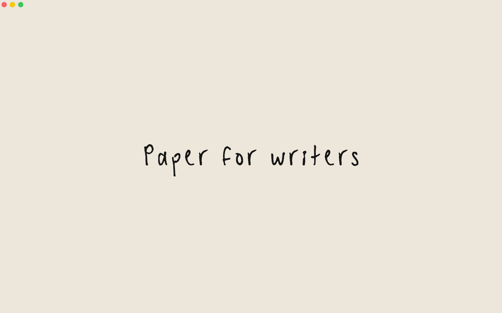

# Paper

Paper is a surface for writers.

Paper is open-source under the [MIT license](LICENSE) so you can customize it the way you like (including using your own handwriting, with [Paper Hand](https://github.com/taylor-fang/handwriting)!)

I created Paper because I wanted a simpler writing space. A place for single-mindedness, akin to a typewriter or physical journal. For more ease, focus, and flow in writing.

There are two ready-made ways to use Paper:

- **Mac app** (recommended): download [here](https://github.com/taylor-fang/Paper/releases/latest/download/Paper.zip), unzip, and drag Paper to Applications. The first time, open it from System Settings > Privacy & Security > Open Anyway
- **Browser version**: [paperwrite.space](https://paperwrite.space)

## Navigation

A sidebar shows up at hover on the right, with sections for **notes**, a **to-do** list, and a small palette of **visual settings**.

Click the **envelope icon** to export as .md or .docx.

Click the **papers icon** to add a new paper (click plus icon) and see past papers.

Your work is automatically saved, but browsers can clear your cache. The Mac app is recommended.

- <ins>On browser</ins>: add Paper to your [Dock](https://support.apple.com/guide/safari/add-to-dock-ibrw9e991864/mac) (on Mac) or [Home Screen](https://support.apple.com/guide/iphone/bookmark-a-website-iph42ab2f3a7/ios) (on iPhone)
- <ins>On the Mac app</ins>: papers are saved as files in the `~/Paper` folder

## Shortcuts

| Keys | Actions |
|---|---|
| ⌘B · ⌘I · ⌘U | Bold, italic, underline |
| ⌘K | Add or edit a link |
| ⌘⌥F | Add a footnote |
| ⌘F | Find on the page |
| `*` or `-` at the start of a line | Start a bulleted list |
| `1.` at the start of a line | Start a numbered list |
| Tab · ⇧Tab (in a list) | Indent · outdent the item |
| ⌘Z · ⇧⌘Z | Undo · redo |
| ⌘S | Save now (Paper also saves as you type) |
| ⌘\\ | Open or close the side bar |
| Esc | Close the side bar |
| ⌘N | New paper in a new window (Mac app) |
| ⌘W | Close the window (Mac app) |
| ⌃⌘F | Full screen (Mac app) |
| ⌘M · ⌘H · ⌘Q | Minimise · hide · quit (Mac app) |

## Small details

- **Calm cursor**: the cursor is translucent and breathes slowly instead of flashing
- **Ta-da**: get a gold star for completing all your to-do tasks
- **No typos**: typos are not pointed out or corrected; take multiple passes through your writing instead (and coin new words!)
- **Keep writing**: on the Mac app, papers deleted from tiny papers go to `~/Paper/removed` first, in case you ever want to come back to past writing

---

I hope Paper can help you clear mental clutter and find a writing practice which feels a bit more natural.

I’d love your feedback! Feel free to [open an issue](https://github.com/taylor-fang/Paper/issues) with any problems you run into.

Paper is under the [MIT license](LICENSE). The Inter typeface it uses is by [Rasmus Andersson](https://rsms.me), under the SIL Open Font License.
